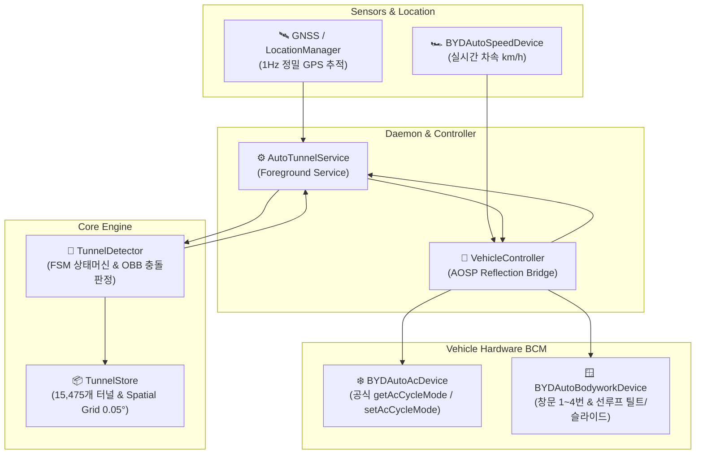
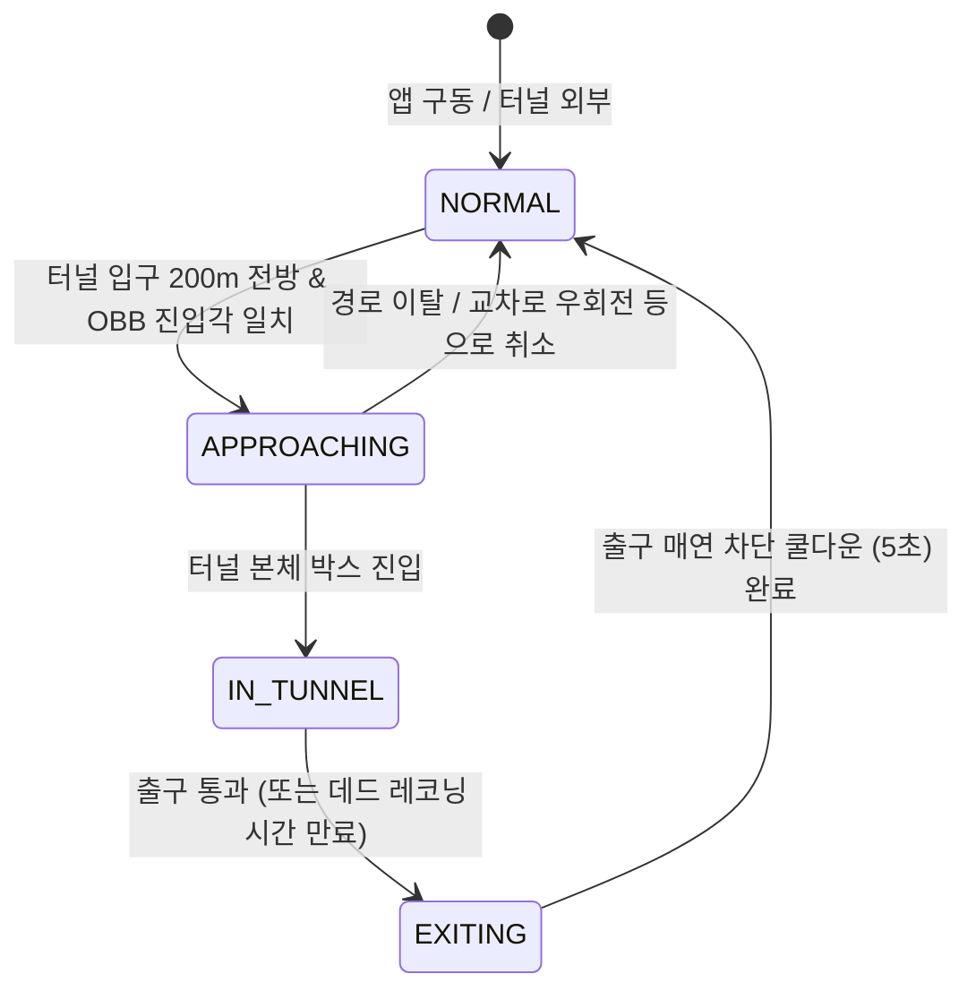

# 🚗 AutoTunnel (오토터널)

<p align="center">
  
  
  
  
  
</p>

<p align="center">
  <b>대한민국 도로 위 터널과 지하차도를 스스로 감지하여<br/>
  공조기 내기 전환 및 창문/선루프를 안전하게 닫고, 통과 후 원래 상태로 자동 복원하는 오토모티브 스마트 제어 솔루션</b>
</p>

<p align="center">
  <b>한국어</b> | <a href="README_EN.md"><b>English</b></a>
</p>

---

## 📌 개요 (Overview)

고속도로나 도심을 주행할 때 터널 내부는 **초미세먼지(PM2.5), 질소산화물, 벤젠 등 유독 배기가스**의 농도가 외부 도로보다 최대 수십 배 이상 높아집니다.  
그러나 운전 중 터널마다 공조기 버튼을 누르고 열려 있는 창문과 선루프를 일일이 닫는 것은 매우 번거롭고 안전 운전을 방해합니다.

**AutoTunnel**은 별도의 외부 서버나 내비게이션 연동 없이, 차량 자체의 **AOSP 오토모티브 하드웨어 브릿지(BYD DiLink)**와 **초고속 공간 인덱싱 오프라인 터널 DB**를 통해 터널 접근을 사전 예측하고 공조 및 차체(창문/선루프)를 지능적으로 제어합니다.

---

## ✨ 핵심 기능 (Key Features)

### 1. 🗺️ 15,475개 대한민국 전체 터널 무손실 커버 & 초고속 공간 격자(Spatial Grid) 인덱싱
- 국토교통부 및 OpenStreetMap(OSM) 기반 도로망 데이터를 정제하여 **고속도로 장대 터널부터 35m 도심형 지하차도까지 총 15,475개**의 터널 데이터를 탑재했습니다.
- 위/경도 $0.05^\circ$ (약 5.5km) 크기의 **Spatial Grid 해시맵**을 메모리에 구성하여, 저사양 차량 안드로이드 헤드유닛에서도 **0.1ms 이내**로 전방 후보 터널을 탐색합니다.

### 2. 📐 OBB(Oriented Bounding Box) 기반 진입각/시선 판정
- 단순 반경(원형) 거리 감지가 아닌, 터널 진입로의 실제 진행 각도와 차량의 실시간 주행 방위각(Bearing)을 벡터 연산합니다.
- 터널 입구 전방 200m에 형성된 **지향성 감지 박스(OBB)**와 차량의 진행 방향이 일치할 때만 작동하므로, 터널 위를 가로지르는 고가도로나 터널 입구 옆 T자 교차로 등에서의 오작동을 차단합니다.

### 3. ⏱️ 터널 내부 GPS 단절 대응 데드 레코닝 (Dead-Reckoning Hold)
- 콘크리트 터널 내부 진입 시 GPS 신호가 두절되거나 수백 미터 오차가 발생하는 문제를 해결했습니다.
- 진입 순간의 실시간 차속(OBD/GPS)과 터널의 정확한 연장 거리를 바탕으로 **예상 통과 시간($T_{expected}$)**을 실시간 연산하여, GPS가 완전히 끊겨도 터널 한가운데서 외기로 풀려버리지 않고 내기 모드를 안정적으로 유지합니다.

### 4. 🌫️ 터널 출구 매연 차단 쿨다운 (Exit Cooldown)
- 터널 출구는 대형 화물차의 배기가스가 강하게 정체되는 구역입니다.
- 출구를 통과한 즉시 외기를 열지 않고, **5초간 쿨다운 지연 시간**을 둔 후 외기 및 창문을 복원하여 잔류 매연의 실내 유입을 방지합니다.

### 5. 🛡️ 안심 3단계 창문/선루프 닫힘 시퀀스 (Safe Closing Sequence)
- 터널 진입 시 창문이 갑작스럽게 닫혀 탑승자의 손이나 목이 끼이는 사고를 방지하기 위해 정교한 시퀀스를 제공합니다:
  - **1단계 (움직임 인지)**: 창문을 살짝 닫는 방향으로 10% 이동하여 모터 소리와 미세한 움직임으로 닫힘을 예고
  - **인지 유예 대기**: 탑승자가 상황을 파악할 수 있도록 3초간 대기
  - **2단계 (안전 틈새)**: 손가락이 빠져나올 수 있는 10% 환기 틈새까지만 닫음
  - **끼임 방지 대기**: 손이나 물건을 뺄 수 있도록 다시 3초간 대기
  - **3단계 (완전 밀폐)**: 남은 틈새를 닫아 매연 100% 차단
- *이미 10% 틈새 환기 모드였던 창문은 오히려 5%를 살짝 열어주는 피드백 후 3초 만에 신속 밀폐(방안 C).*

### 6. 🔄 원래 개폐 수치(%) 무지연 즉시 복원
- 터널 진입 전 운전석, 동승석, 뒷좌석 2개 및 선루프의 **열림 수치($1\% \sim 100\%$)**를 백업합니다.
- 터널 통과 후에는 닫을 때와 달리 딜레이 없이 **원래 열려 있던 비율 그대로 한 번에 원상 복원**합니다. (닫혀 있던 창문은 모터 보호를 위해 건드리지 않음)

### 7. ⚡ BCM 과전류 보호 시차 제어 (Staggered Delay)
- 창문 4개와 선루프 모터를 동시에 구동하면 순간 돌입 전류(Inrush Current)로 인해 차량 BCM 퓨즈에 무리가 갈 수 있습니다.
- 백그라운드 워커 스레드에서 모터 구동 명령마다 **150ms ~ 200ms의 시차**를 두고 순차 작동시켜 전기적 안정성을 보장합니다.

### 8. 🗺️ 직관적인 지도 UI & 비주얼 터널 DB 편집기
- **전체화면 OSM 지도**: 메인 화면의 85% 이상을 시원한 오픈스트리트맵(OSM) 지도로 구성하여 주행 중 직관적인 상황 확인 가능.
- **내비게이션 화살표 마커**: 차량의 GPS 수신 방위각에 맞춰 회전하며, 정차 중에도 마지막 진행 각도를 보존.
- **원터치 컴팩트 토글 바**: `[전원]` │ `[창문 연동]` `[안전 닫기]` `[알림음]`의 4대 핵심 토글 제공.
- **비주얼 터널 편집기**: 지도에서 터널 선이나 감지 박스를 직접 터치하여 방위각 미세 조정($\pm 1^\circ, \pm 5^\circ$), 시작 감지 거리 조정, 일방통행 지정, 신규 터널 추가/삭제 및 JSON 백업/복원 지원.

### 9. 🎵 네이티브 오디오 알림 (Opus Media Player)
- 기계식 전자음이 아닌 부드럽고 명확한 Opus 음원(`tunnel_start.opus`, `tunnel_end.opus`)을 안드로이드 네이티브 `MediaPlayer`로 재생하며, 재생 완료 즉시 메모리를 자동 해제합니다.

### 10. 🔋 배터리 & CPU 제로 전원 관리
- 상단 `[전원]` 스위치를 끄면 공조/창문을 즉시 복원하고 **백그라운드 GPS 리스너를 완전히 등록 해제**하여 대기 상태에서의 전력 및 CPU 소모를 0으로 만듭니다.

---

## 🏗️ 시스템 아키텍처 (Architecture)



### 상태 전이 머신 (Finite State Machine)



---

## 📱 사용자 인터페이스 (UI)

### 메인 화면
```
┌─────────────────────────────────────────────────────────────┐
│  [ 상태 배너 ]  정상 주행 중 (외기 순환)                     │
├─────────────────────────────────────────────────────────────┤
│  [전원] │ [창문 연동]  [안전 닫기]  [알림음]                  │
├─────────────────────────────────────────────────────────────┤
│                                                             │
│                                                             │
│                      시원하고 넓은 OSM 지도                  │
│                        (화면 85% 이상 차지)                  │
│                                                             │
│                                     [📍 내 위치 / 추적 중]   │
│                                     [터널 DB 편집기]        │
├─────────────────────────────────────────────────────────────┤
│  속도: 65 km/h | 후보 터널: 3개 | GPS 정확도: 4m             │
└─────────────────────────────────────────────────────────────┘
```

- **상단 상태 배너**: 주행 상태(외기/내기), 터널 접근 및 통과 카운트다운, 창문 닫힘 상태를 한눈에 안내합니다.
- **지도 플로팅 버튼**:
  - `[📍 내 위치]`: 터치 시 차량 위치를 중앙에 고정하고 실시간 추적을 활성화합니다. 지도를 자유롭게 스크롤하면 자동으로 추적이 풀립니다.
  - `[터널 DB 편집기]`: 비주얼 터널 편집 화면으로 즉시 이동합니다.

---

## 🛠️ 개발 환경 및 빌드 (Build & Installation)

### 요구 사양 (Prerequisites)
- **Android Studio**: Ladybug (2024.2.1) 이상 권장
- **JDK**: Java 17 이상
- **Compile SDK**: Android 36 (VanillaIceCream)
- **Min SDK**: Android 26 (Android 8.0 Oreo 이상)
- **지원 디바이스**: AOSP 기반 안드로이드 오토모티브 시스템 (BYD DiLink 3.0 / 4.0 / 5.0 탑재 차량 등)

### 빌드 명령어 (CLI)

```bash
# 저장소 복제
git clone https://github.com/PoorGrammerA/BydAutoTunnel.git
cd BydAutoTunnel

# 단위 테스트 실행
./gradlew testDebugUnitTest

# 디버그 APK 빌드
./gradlew assembleDebug

# 릴리즈 APK 빌드
./gradlew assembleRelease
```

빌드된 APK 파일 위치:
`app/build/outputs/apk/debug/app-debug.apk`

---

## 🔒 필요 권한 (Permissions)

AutoTunnel은 백그라운드 실시간 터널 감지 및 차량 하드웨어 제어를 위해 다음 권한을 사용합니다:

| 권한 | 용도 |
| :--- | :--- |
| `ACCESS_FINE_LOCATION` | 터널 진입 여부 판정을 위한 고정밀 GPS 위치 수신 |
| `FOREGROUND_SERVICE_LOCATION` | 화면이 꺼지거나 다른 내비게이션 사용 중에도 백그라운드 터널 감지 유지 |
| `RECEIVE_BOOT_COMPLETED` | 차량 시동 시 자동 서비스 시작 |
| `POST_NOTIFICATIONS` | 안드로이드 13+ 포그라운드 서비스 동작 알림 |
| `BYDAUTO_AC_*` | BYD 공조기(내기/외기) 상태 조회 및 제어 |
| `BYDAUTO_SPEED_GET` | 터널 내부 데드 레코닝 시간 계산을 위한 실시간 차속 조회 |

---

## 📂 프로젝트 구조 (Project Structure)

```
AutoTunnel/
├── app/
│   ├── src/main/
│   │   ├── assets/
│   │   │   └── tunnels_kr.bin          # 15,475개 터널 바이너리 데이터베이스
│   │   ├── java/com/poorgrammera/autotunnel/
│   │   │   ├── data/                   # SharedPreferences 설정 및 SQLite 커스텀 오버라이드
│   │   │   ├── detector/               # TunnelDetector (FSM 상태 머신 & OBB 진입 감지)
│   │   │   ├── model/                  # Tunnel, OrientedBox, GeoUtils 등 기하/지리 연산 모델
│   │   │   ├── receiver/               # BootReceiver (부팅 시 자동 실행)
│   │   │   ├── service/                # AutoTunnelService (핵심 백그라운드 데몬)
│   │   │   ├── ui/                     # MainActivity, TunnelEditorActivity, UiUtils
│   │   │   └── vehicle/                # VehicleController (BYD 하드웨어 리플렉션 브릿지)
│   │   ├── res/
│   │   │   ├── raw/                    # tunnel_start.opus, tunnel_end.opus 오디오 리소스
│   │   │   └── layout/                 # activity_main.xml, activity_tunnel_editor.xml
│   │   └── AndroidManifest.xml
│   └── build.gradle
├── docs/
│   └── SPECIFICATION.md                # 시스템 기술 명세서
├── LICENSE                             # Apache-2.0 라이선스
└── README.md                           # 프로젝트 메인 문서
```

---

## 🤝 기여 및 커스텀 안내 (Fork & Customization)

- 본 프로젝트는 개인 차량 주행 편의를 위해 제작된 오픈소스 프로젝트입니다.
- **메인테이너가 상시 유지보수나 Pull Request(PR) 검토/머지를 빈번하게 진행하기 어렵습니다.**
- 기능 개선, 새로운 차종 연동, 버그 수정 또는 터널 DB 커스텀이 필요하신 경우 언제든지 **저장소를 Fork(포크)하여 자유롭게 수정하고 개인 빌드로 배포하여 사용**해 주시기 바랍니다.
- 자세한 내용은 [CONTRIBUTING.md](CONTRIBUTING.md)를 참고해 주세요.

---

## 📄 라이선스 (License)

이 프로젝트는 **Apache License 2.0**에 따라 라이선스가 부여됩니다. 자세한 내용은 [LICENSE](LICENSE) 파일을 참조하십시오.

```
Copyright 2026 AutoTunnel Authors

Licensed under the Apache License, Version 2.0 (the "License");
you may not use this file except in compliance with the License.
You may obtain a copy of the License at

    http://www.apache.org/licenses/LICENSE-2.0
```

---

## ⚠️ 면책 조항 (Disclaimer)

- **서드파티 독립 프로젝트**: 본 소프트웨어는 개인 편의 및 연구를 위해 개발된 제3자 독립 오픈소스 프로젝트입니다. **BYD Auto(비야디) 또는 관련 계열사의 공식 소프트웨어가 아니며**, 어떠한 공식 제휴, 보증, 후원도 받지 않았습니다.
- **상표권 고지**: 'BYD', 'DiLink' 등 본 문서 및 코드에 언급된 모든 상표, 상호 및 서비스 마크는 해당 소유자의 자산이며, 오직 호환성 식별 및 설명 목적으로만 사용되었습니다.
- **안전 운전 최우선**: 실제 차량에 적용하여 운행할 때는 주변 도로 상황과 안전 운전을 항상 최우선으로 고려해야 합니다.
- **책임 한계**: 개발자 및 기여자는 본 소프트웨어의 사용, 수정, 오작동 또는 미작동으로 인해 발생하는 차량 부품 손상, 고장, 과태료, 교통사고 및 직·간접적인 손해에 대해 어떠한 법적 책임도 지지 않습니다. 모든 사용과 적용의 책임은 사용자 본인에게 있습니다.
