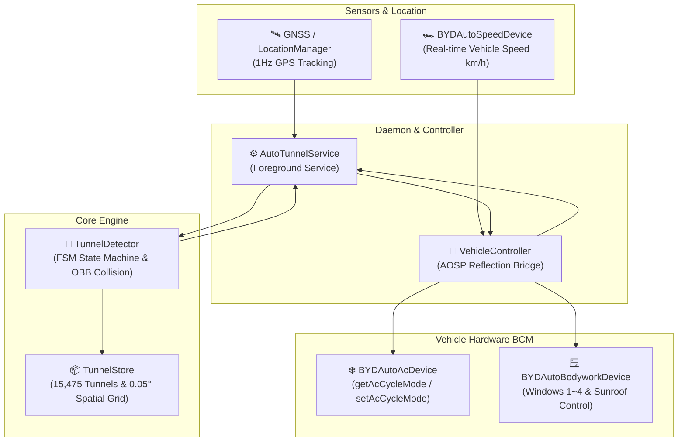

# 🚗 AutoTunnel

<p align="center">
  
  
  
  
  
</p>

<p align="center">
  <b>Smart automotive control solution that automatically detects tunnels and underpasses,<br/>
  switches HVAC to air recirculation, safely closes open windows & sunroof, and restores them after exit.</b>
</p>

<p align="center">
  <a href="README.md"><b>한국어 문서 (Korean)</b></a> | <b>English</b>
</p>

---

## 📌 Overview

Inside highway and urban tunnels, concentrations of harmful exhaust fumes, fine dust (PM2.5), and nitrogen oxides can be dozens of times higher than on open roads. Manually switching air circulation and closing open windows every time you approach a tunnel is inconvenient and distracts from safe driving.

**AutoTunnel** runs entirely offline on the vehicle's Android Open Source Project (AOSP) system (compatible with BYD DiLink). It uses a pre-indexed spatial grid tunnel database and hardware reflection bridges to predict tunnel entry and safely manage HVAC and bodywork automatically.

---

## ✨ Key Features

### 1. 🗺️ 15,475 Tunnels & Ultra-Fast Spatial Grid Indexing
- Comprehensive offline database containing 15,475 tunnels and underpasses across South Korea (from 35-meter urban passes to long highway tunnels).
- Memory-resident spatial grid ($0.05^\circ \approx 5.5\text{km}$) queries nearby candidate tunnels in **under 0.1ms**, running smoothly even on modest automotive head units.

### 2. 📐 Oriented Bounding Box (OBB) & Heading Angle Validation
- Validates directional heading vectors rather than using simple circular distance radii.
- Features a 200m entry trigger bounding box that activates only when the vehicle's driving bearing aligns with the tunnel corridor angle, eliminating false triggers on parallel roads, overpasses, or T-intersections.

### 3. ⏱️ Dead-Reckoning Hold During Tunnel GPS Blackout
- When GPS signal is lost or degraded inside concrete tunnels, AutoTunnel calculates expected transit time:
  $$T_{expected} = \frac{L_{tunnel}}{V_{vehicle}} + 8\text{s (safety margin)}$$
- Prevents premature cancellation while traveling inside the tunnel, ensuring recirculation remains active.

### 4. 🌫️ 5-Second Post-Exit Cooldown
- Exhaust fumes linger densely near tunnel exits. AutoTunnel holds recirculation for an extra 5 seconds after clearing the exit portal before opening fresh air and restoring windows.

### 5. 🛡️ 3-Stage Safe Closing Sequence (Anti-Pinch)
- To prevent finger or neck entrapment when closing windows:
  1. **Stage 1 (Movement Cue)**: Closes windows by 10% from current position to alert occupants with sound and motion.
  2. **Awareness Delay**: Waits 3 seconds.
  3. **Stage 2 (Vent Gap)**: Closes up to a 10% safety ventilation gap.
  4. **Clearance Delay**: Waits 3 seconds for passengers to clear hands or items.
  5. **Stage 3 (Full Seal)**: Seals completely to block fumes.
- *Windows already at a 10% vent gap slightly open by 5% first to signal activation, then fully seal after 3 seconds.*

### 6. 🔄 Instant Restoration of Exact Open Percentages
- Remembers each window's exact open percentage ($1\% \sim 100\%$) and sunroof tilt/slide position.
- Restores them without delay upon tunnel completion. Windows that were already closed are left untouched.

### 7. ⚡ Staggered Motor Delay for BCM Protection
- Dispatches motor commands with a **150ms ~ 200ms stagger** on a background worker thread, protecting the vehicle's Body Control Module (BCM) from inrush current spikes.

### 8. 🗺️ Visual Map UI & Tunnel Database Editor
- **Full-Screen OSM Map**: Covers 85%+ of screen estate with real-time directional vehicle arrow navigation.
- **Visual Editor**: Tap any tunnel polyline or bounding box on the map to adjust bearing ($\pm 1^\circ, \pm 5^\circ$), customize trigger distance, toggle one-way/two-way, create new custom tunnels, or backup/restore via JSON.

### 9. 🎵 Native Audio Alerts (Opus Media Player)
- Plays gentle, distinct Opus audio alerts (`tunnel_start.opus`, `tunnel_end.opus`) through Android's native `MediaPlayer` with automatic resource cleanup upon playback completion.

### 10. 🔋 Zero Battery & CPU Standby
- Turning off the master power switch restores HVAC/windows immediately and unregisters the background location listener, reducing standby battery and CPU consumption to zero.

---

## 🏗️ Architecture



---

## 🛠️ Build & Installation

### Prerequisites
- **Android Studio**: Ladybug (2024.2.1) or higher
- **JDK**: Java 17+
- **Compile SDK**: Android 36
- **Min SDK**: Android 26 (Android 8.0 Oreo+)
- **Target Platform**: AOSP-based automotive systems (e.g. BYD DiLink 3.0 / 4.0 / 5.0)

### Build Commands

```bash
# Clone repository
git clone https://github.com/PoorGrammerA/BydAutoTunnel.git
cd BydAutoTunnel

# Run unit tests
./gradlew testDebugUnitTest

# Build debug APK
./gradlew assembleDebug

# Build release APK
./gradlew assembleRelease
```

Generated APK: `app/build/outputs/apk/debug/app-debug.apk`

---

## 🤝 Fork & Customization Notice

- This project is an open-source utility developed for personal driving convenience.
- **The maintainer does not actively review, merge Pull Requests (PRs), or provide frequent maintenance.**
- If you need bug fixes, new features, model-specific adaptations, or custom tunnel data, you are warmly encouraged to **Fork this repository and maintain your own customized build**.
- See [CONTRIBUTING.md](CONTRIBUTING.md) for further details.

---

## 📄 License

This project is licensed under the **Apache License 2.0**. See the [LICENSE](LICENSE) file for details.

```
Copyright 2026 AutoTunnel Authors

Licensed under the Apache License, Version 2.0 (the "License");
you may not use this file except in compliance with the License.
You may obtain a copy of the License at

    http://www.apache.org/licenses/LICENSE-2.0
```

---

## ⚠️ Disclaimer

- **Third-Party Independent Project**: AutoTunnel is an independent open-source project created for personal convenience and research. **It is NOT an official software produced, sponsored, endorsed, or affiliated with BYD Auto Co., Ltd. or any of its subsidiaries.**
- **Trademark Notice**: All trademarks, service marks, and trade names (including 'BYD', 'DiLink', etc.) referenced in this project belong to their respective owners and are used strictly for compatibility description and identification purposes.
- **Safety First**: Always prioritize road safety, alertness, and local traffic laws while operating a vehicle.
- **Limitation of Liability**: The authors and contributors provide this software "AS IS" without warranty of any kind, either express or implied. In no event shall the authors or contributors be liable for any direct, indirect, incidental, punitive, or consequential damages (including vehicle malfunction, hardware wear, fines, or accidents) arising from the use or inability to use this software. Use at your own risk.
