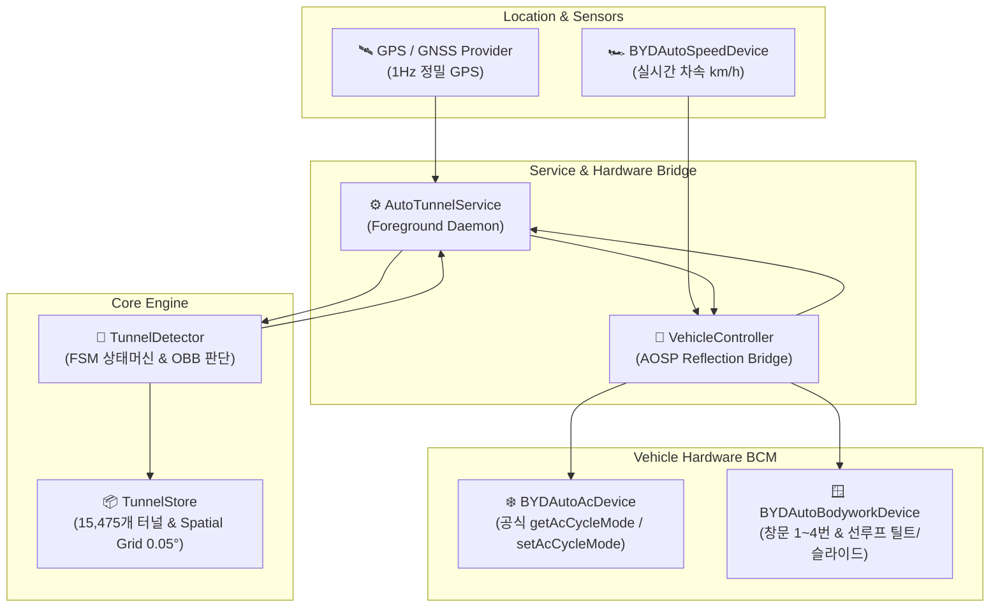
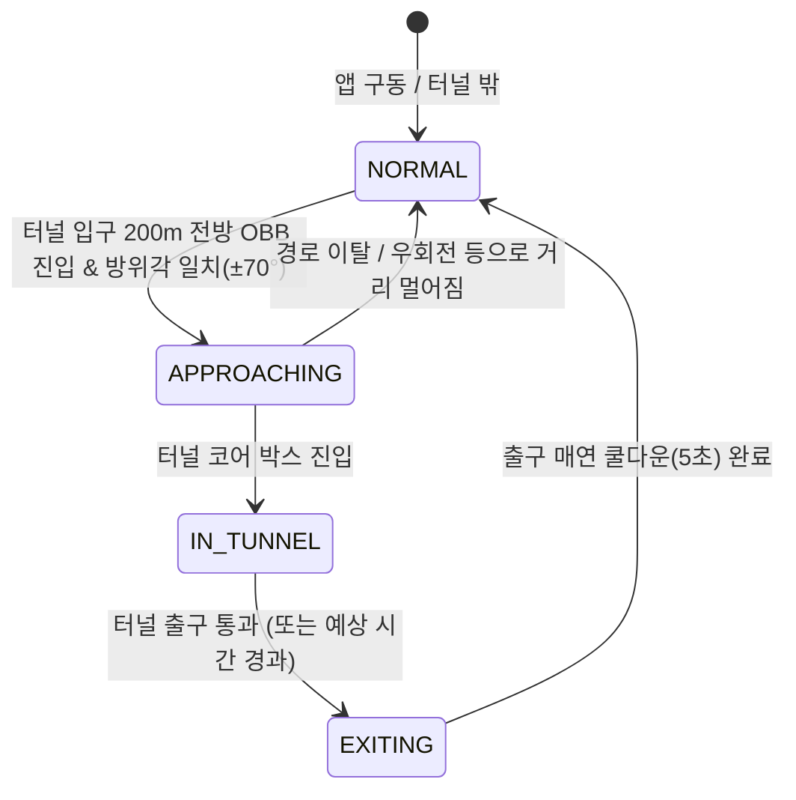
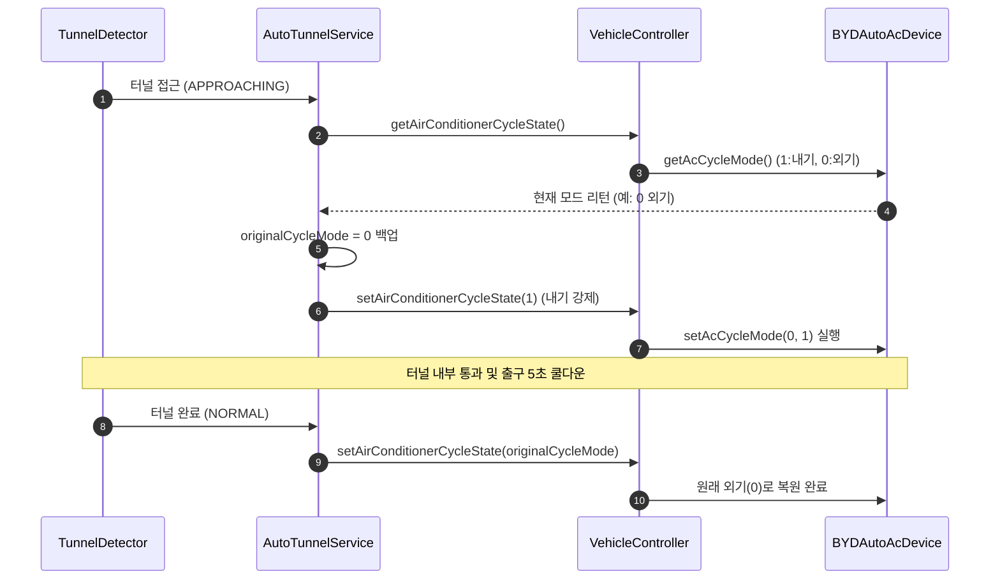

# AutoTunnel 시스템 기술 명세서 (Specification)

> **AutoTunnel (오토터널)**: 차량이 터널 및 지하차도에 진입할 때 자동으로 공조기를 내기 모드로 전환하고 창문/선루프를 안전하게 닫아 매연 및 미세먼지를 차단하며, 터널 통과 후 원래 공조 상태와 창문 개폐 수치(%)로 자동 복원하는 AOSP 기반 오토모티브 스마트 제어 솔루션입니다.

---

## 목차
1. [시스템 아키텍처 개요](#1-시스템-아키텍처-개요)
2. [터널 감지 및 판단 알고리즘](#2-터널-감지-및-판단-알고리즘)
   - [2.1 터널 데이터베이스 및 공간 인덱싱](#21-터널-데이터베이스-및-공간-인덱싱)
   - [2.2 고정밀 FSM 상태 머신 & OBB 진입각 판정](#22-고정밀-fsm-상태-머신--obb-진입각-판정)
   - [2.3 GPS 단절 대응 데드 레코닝 (Dead-Reckoning Hold)](#23-gps-단절-대응-데드-레코닝-dead-reckoning-hold)
   - [2.4 출구 매연 방지 쿨다운 (Exit Cooldown)](#24-출구-매연-방지-쿨다운-exit-cooldown)
3. [창문 및 선루프 제어 시스템](#3-창문-및-선루프-제어-시스템)
   - [3.1 BYD BCM 하드웨어 인터페이스](#31-byd-bcm-하드웨어-인터페이스)
   - [3.2 실시간 개폐 수치(%) 판독 및 백업](#32-실시간-개폐-수치-판독-및-백업)
   - [3.3 다단계 안심 닫힘 시퀀스 (Safe Closing Sequence)](#33-다단계-안심-닫힘-시퀀스-safe-closing-sequence)
   - [3.4 원래 수치(%) 무지연 즉시 복원](#34-원래-수치-무지연-즉시-복원)
   - [3.5 BCM 과전류 보호 시차 제어](#35-bcm-과전류-보호-시차-제어)
4. [공조기(A/C) 제어 로직](#4-공조기ac-제어-로직)
5. [네이티브 오디오 알림 시스템](#5-네이티브-오디오-알림-시스템)
6. [사용자 인터페이스 및 비주얼 터널 편집기](#6-사용자-인터페이스-및-비주얼-터널-편집기)

---

## 1. 시스템 아키텍처 개요

AutoTunnel은 차량의 백그라운드에서 상시 구동되는 `AutoTunnelService`를 중심으로 하드웨어 제어, 위치 추적, 공간 색인 엔진이 유기적으로 연동됩니다.



---

## 2. 터널 감지 및 판단 알고리즘

### 2.1 터널 데이터베이스 및 공간 인덱싱
- **바이너리 에셋**: `app/src/main/assets/tunnels_kr.bin`
- **데이터 정제**: 대한민국 도로 터널 및 지하차도 **총 15,475개** 무손실 수록 (35m 도심형 지하차도부터 10km 이상 장대 터널까지 전역 커버).
- **Spatial Grid 색인**: 위/경도 $0.05^\circ$ (약 5.5km) 격자 해시맵을 메모리에 사전 구축.
  - 앱 시작 시 파싱 및 색인 시간: **15ms 이내**
  - 실시간 반경 2km 후보 터널 검색: **0.1ms 이내**

### 2.2 고정밀 FSM 상태 머신 & OBB 진입각 판정
차량의 위치($lat, lng$), 이동 방위각($bearing$), 차량 속도($speed$)를 입력받아 4가지 상태를 천이합니다.



1. **NORMAL**: 터널 주변 2km 이내 후보군을 모니터링하며 정상 주행(외기) 유지.
2. **APPROACHING**:
   - 터널 입구 전방 200m에 형성된 **지향성 감지 박스(OBB: Oriented Bounding Box)** 내에 차량이 진입하고,
   - 차량 진행 방위각과 터널 진입각의 차이가 임계값($70^\circ$) 이내로 일치할 때 진입.
   - **동작**: 공조기 내기 강제 전환 및 창문/선루프 안전 닫힘 시퀀스 개시, `tunnel_start.opus` 알림음 재생.
3. **IN_TUNNEL**: 터널 코어 박스 내부를 주행 중인 상태.
4. **EXITING**: 출구를 통과한 후, 출구 주변 매연 유입 방지를 위해 **5초간 내기 유지(쿨다운)**.
5. **NORMAL 복귀**: 쿨다운 완료 후 원래 공조 상태 복원, 닫혔던 창문/선루프 즉시 원복, `tunnel_end.opus` 알림음 재생.

### 2.3 GPS 단절 대응 데드 레코닝 (Dead-Reckoning Hold)
- 터널 내부에 진입하면 콘크리트 및 산악 지형으로 인해 GPS 신호가 두절되거나 오차가 수백 미터로 급증합니다.
- `IN_TUNNEL` 상태에 진입하면 터널 연장 거리($L_{meters}$)와 진입 당시 차속($V_{km/h}$)을 바탕으로 **예상 주행 소요 시간($T_{expected}$)**을 계산합니다:
  $$T_{expected} = \frac{L}{V} + 8\text{초 (안전 마진)}$$
- GPS 신호가 완전히 끊기더라도 타이머 기반의 데드 레코닝(Dead-Reckoning Hold)을 유지하여 터널 내부에서 상태가 풀리지 않습니다.

### 2.4 출구 매연 방지 쿨다운 (Exit Cooldown)
터널 출구는 대형 화물차와 차량들이 배출한 매연이 산바람이나 터널 통풍에 의해 집중 체류하는 구간입니다. 출구를 통과하자마자 즉시 외기를 열면 매연이 실내로 유입되므로, **출구 통과 후 기본 5초 동안 쿨다운을 거친 뒤 복원**합니다.

---

## 3. 창문 및 선루프 제어 시스템

### 3.1 BYD BCM 하드웨어 인터페이스
BYD AOSP 환경의 Body Control Module과 리플렉션(Reflection)으로 연동합니다.

| 제어 영역 (Area) | 하드웨어 명칭 | 개폐 수치 읽기 API | 제어 API |
| :---: | :---: | :---: | :---: |
| **1** | 운전석 (LF) | `getWindowOpenPercent(1)` | `setAllWindowState`, `setBodyWindowCtrlState`, Feature ID |
| **2** | 동승석 (RF) | `getWindowOpenPercent(2)` | `setAllWindowState`, `setBodyWindowCtrlState`, Feature ID |
| **3** | 좌측 뒷좌석 (LR) | `getWindowOpenPercent(3)` | `setAllWindowState`, `setBodyWindowCtrlState`, Feature ID |
| **4** | 우측 뒷좌석 (RR) | `getWindowOpenPercent(4)` | `setAllWindowState`, `setBodyWindowCtrlState`, Feature ID |
| **5** | 선루프 (MoonRoof) | `getWindowOpenPercent(5)` | `voiceCtlMoonRoof`, `setMoonRoofState` |

### 3.2 실시간 개폐 수치(%) 판독 및 백업
- `getOpenWindows()`를 통해 1~5번 위치 중 현재 열려 있는 창문($Percent > 0$)의 수치를 `Map<Integer, Integer>`에 백업합니다.
- 0%인 창문(이미 닫힌 창문)은 제어 대상에서 제외하여 불필요한 모터 소음과 전력 소모를 방지합니다.

### 3.3 다단계 안심 닫힘 시퀀스 (Safe Closing Sequence)
탑승자의 손가락 끼임 방지와 갑작스러운 닫힘에 따른 놀람/풍압 충격을 방지하기 위해 정교한 단계별 시퀀스를 실행합니다.

```mermaid
flowchart TD
    Start["터널 진입 감지 & 현재 열림 수치 백업"] --> Check{"열림 수치 P"}
    
    Check -->|P > 15% (크게 열림)| S1_Normal["[1단계] 10% 닫힘 예고 (P - 10%)<br/>창문이 살짝 올라가며 닫힘 인지"]
    S1_Normal --> Wait1["⏳ 3초 인지 유예 대기"]
    Wait1 --> S2_Normal["[2단계] 10% 틈새까지 닫힘 (90% 닫힘)<br/>손가락 끼임 방지 틈새 확보"]
    S2_Normal --> Wait2["⏳ 3초 끼임 방지 대기"]
    Wait2 --> S3_Normal["[3단계] 완전 밀폐 (0% 닫힘)"]
    
    Check -->|P <= 15% (원래 10% 틈새)| S1_Small["[방안 C] 오히려 5% 살짝 열림 (P + 5%)<br/>창문이 살짝 내려가며 모터 작동 예고"]
    S1_Small --> WaitSmall["⏳ 3초 인지 유예 대기"]
    WaitSmall --> S3_Small["[완전 밀폐] 곧바로 완전 닫힘 (0%)<br/>3초 후 신속 차단"]
```

#### 케이스 A: 창문이 15% 초과로 열려 있는 경우
1. **1단계 (10% 닫힘 예고)**: 현재 위치에서 10%만큼 닫는 방향으로 이동 ($P - 10\%$). 창문이 스르륵 올라가며 탑승자에게 닫힘 동작을 예고.
2. **3초 인지 대기**: 탑승자가 창문이 닫힌다는 것을 인지할 수 있는 유예 시간.
3. **2단계 (10% 틈새 닫힘)**: 손가락/목/물건이 끼이지 않도록 마지막 10% 틈새(환기 모드)까지만 닫음.
4. **3초 끼임 방지 대기**: 안전 공간에서 손이나 물건을 뺄 수 있도록 3초간 대기.
5. **3단계 (완전 밀폐)**: 남은 10% 틈새마저 완전히 닫아 터널 매연 100% 차단.

#### 케이스 B: 원래 15% 이하로 열려 있는 경우 (예: 10% 환기 틈새) — 방안 C
- **5%를 살짝 더 열어줌 ($10\% \rightarrow 15\%$)**: 창문이 살짝 내려가면서 모터 소리와 시각적 움직임으로 "자동 닫힘 작동 시작"을 명확히 피드백.
- **3초 안전 대기 후 즉시 완전 닫힘**: 2중 대기 없이 3초 만에 신속하게 완전 밀폐.

### 3.4 원래 수치(%) 무지연 즉시 복원
- 터널 통과 및 출구 쿨다운(5초) 종료 시:
  - 진입 전 백업해둔 원래 수치($P\%$)로 **지연 없이 즉시 한 번에 복원**합니다.
  - 선루프는 틸트(`voiceCtlMoonRoof(5)`) 또는 슬라이드 위치로 정확하게 물리 복원됩니다.

### 3.5 BCM 과전류 보호 시차 제어
- 백그라운드 단일 스레드 풀(`VehicleController-Worker`)에서 각 창문 명령마다 **150ms ~ 200ms의 시차(Staggered Delay)**를 두고 순차 구동하여 돌입 전류로 인한 퓨즈 트립을 방지합니다.

---

## 4. 공조기(A/C) 제어 로직



- **공식 API 사용**: `getAcCycleMode()` 및 `setAcCycleMode(setSource, mode)`를 호출하여 신뢰성 있는 제어를 수행합니다.
- **원래 내기 순환이었던 경우**: 터널 진입 전 이미 내기 순환이었던 차량은 출차 후에도 내기 모드를 그대로 유지합니다.

---

## 5. 네이티브 오디오 알림 시스템

- **엔진**: 안드로이드 네이티브 `MediaPlayer`
- **음원 포맷**: 고음질/초경량 Opus 오디오 에셋 (`app/src/main/res/raw/`)
  - `tunnel_start.opus`: 터널 진입 시 부드러운 시작 알림
  - `tunnel_end.opus`: 터널 탈출 및 외기/창문 복원 완료 알림
- **리소스 라이프사이클**: `setOnCompletionListener`를 통해 재생 즉시 미디어플레이어 리소스를 시스템에 반환하여 메모리 누수를 원천 방지합니다.

---

## 6. 사용자 인터페이스 및 비주얼 터널 편집기

### 6.1 메인 액티비티 UI
- **최상단 상태 배너**: 주행 상태, A/C 모드, 터널 카운트다운, 창문 닫힘 상태 일원화 안내.
- **컴팩트 토글 바 (단 1줄)**:
  - `[전원]`: 앱의 메인 마스터 스위치 (OFF 시 백그라운드 GPS 리스너를 해제하여 배터리/CPU 소모 0).
  - `[창문 연동]`: 터널 진입 시 창문/선루프 자동 닫기 및 출차 후 원복.
  - `[안전 닫기]`: 3단계 손끼임 방지 안전 닫힘 활성화 여부.
  - `[알림음]`: 터널 진입/탈출 시 Opus 오디오 알림 출력 여부.
- **전체화면 OSM 지도**:
  - 화면의 85% 이상을 시원한 지도로 표출.
  - 차량의 이동 방향에 따라 부드럽게 회전하는 내비게이션 화살표 마커 탑재.
  - 지도 우측 하단 플로팅 버튼: `[📍 내 위치 / 추적 중]`, `[터널 DB 편집기]`.

### 6.2 비주얼 터널 DB 편집기 (`TunnelEditorActivity`)
- 지도상의 터널 선(Polyline), 코어 박스, 진입 감지 박스(OBB)를 터치하여 즉시 상세 편집 패널 진입.
- **터널 방위각 미세 조정**: $\pm 1^\circ, \pm 5^\circ$ 단위로 감지 박스 지향 각도 수정.
- **시작 감지 거리 설정**: 특정 터널에 대한 150m / 200m / 250m 감지 거리 개별 지정.
- **일방통행/양방향 토글**: 분리 고속도로 터널과 일반 양방향 터널 구분.
- **신규 터널 추가 모드**: 지도 탭 2번(입구/출구)으로 새로운 터널 즉시 생성.
- **JSON 백업/복원**: 커스텀 터널 및 수정 내역을 JSON 파일로 손쉽게 내보내거나 기기간 병합/동기화 가능.
